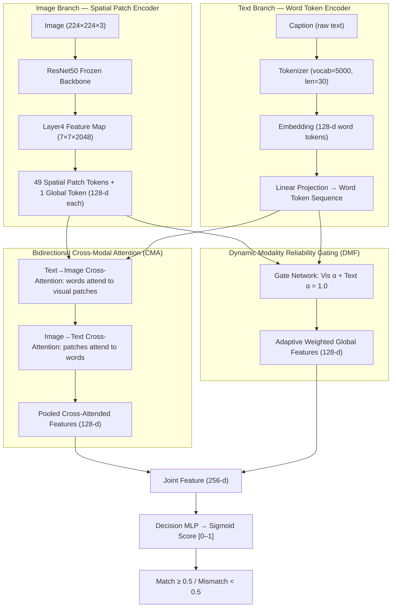

# Multimodal Late-Fusion: Image-Text Matching (ITM)

An end-to-end deep learning framework for **Image-Text Matching (ITM)** using a novel **Cross-Attention & Dynamic-Gated (CADF-ITM)** architecture alongside a **Baseline Late-Fusion** model — for comparison, research, and interactive inference.

> **Research Project** — Assam Science and Technology University, 2026

---

## 🏆 Illustrative Example Results (8 Image-Text Pairs)

| Pair | Type | Baseline (Late Fusion) | **CADF-ITM (Novel)** |
|------|------|:---:|:---:|
| Figure 1 + Caption 1 | ✅ Positive | PASS | **PASS** |
| Figure 2 + Caption 2 | ✅ Positive | ❌ FAIL | **PASS** |
| Figure 3 + Caption 3 | ✅ Positive | PASS | **PASS** |
| Figure 4 + Caption 4 | ✅ Positive | PASS | **PASS** |
| Figure 1 + Caption 2 | ❌ Negative | PASS | **PASS** |
| Figure 2 + Caption 3 | ❌ Negative (Hard) | ❌ FAIL | **PASS** |
| Figure 3 + Caption 4 | ❌ Negative | PASS | **PASS** |
| Figure 4 + Caption 1 | ❌ Negative | PASS | **PASS** |
| **Total** | | **6/8 (75%)** | **🥇 8/8 (100%)** |

---

## 🏛️ Architecture: What Makes CADF-ITM Different



### Key Differentiators vs Prior Literature

| Feature | Baseline (This Project) | CADF-ITM (This Project) | Prior Work (Jiao 2024, Xiang 2026) |
|---------|:---:|:---:|:---:|
| Spatial patch tokens | ❌ GAP only | ✅ 49 patches | ✅ CMA |
| Cross-modal attention | ❌ None | ✅ Bidirectional | ✅ Unidirectional |
| Dynamic modality gates | ❌ Static 50/50 | ✅ Sample-adaptive | ✅ Confidence gates |
| Joint loss | BCE only | BCE + Cosine + Entropy | Task + Alignment |
| Modality collapse prevention | ❌ None | ✅ Entropy penalty | ✅ Regularization |

---

## 📂 Project Structure

```
multi-model-Fusion-main/
│
├── 🌐 app.py                          Flask Web Application (the product)
├── 🖼️  templates/index.html            Dark-mode UI — upload, caption, compare
│
├── 🧠 model.py                         Baseline Late-Fusion Model (PyTorch)
├── 🚀 model_advanced.py                CADF-ITM: Cross-Attention + Dynamic Gates
│
├── 🏋️  train.py                         Baseline training pipeline
├── 🏋️  train_advanced.py                CADF-ITM training (BCE + Contrastive + Entropy)
│
├── 📝 tokenizer.py                     Word vocabulary builder + encoder
├── 📊 dataset.py                       ITM pair generator + PyTorch Dataset
│
├── 🔍 predict.py                       CLI inference tool
├── 🧪 test_illustrative_example.py     Comparative benchmark (Baseline vs CADF-ITM)
│
├── 📥 download_dataset.py              Kaggle Flickr8k downloader + verifier
│
├── 📖 vocab.json                       Saved vocabulary (if available)
│
├── 💾 Model checkpoints               Generated locally during training; not committed
│
├── 🚀 START_APP.bat                    One-click launch (Windows)
└── 📋 requirements.txt                 Python dependencies
```

---

## 🚀 Quick Start

### 1. Install dependencies
```bash
pip install -r requirements.txt
```

### 2. Launch the Web App
**Windows (double-click):** `START_APP.bat`

**Or via terminal:**
```bash
python app.py
```

Open your browser at **http://localhost:5000**

---

## 🔧 Training

### Train Baseline Model
```bash
python train.py --epochs 20 --batch_size 8 --lr 0.001
```

### Train Novel CADF-ITM Model
```bash
python train_advanced.py --epochs 20 --batch_size 8 --lr 0.001
```

---

## 🧪 Testing & Benchmarking

### Run full comparative benchmark
```bash
python test_illustrative_example.py
```

### CLI single-pair inference
```bash
python predict.py --image "data/Images/1009434119_febe49276a.jpg" \
                  --caption "A black dog running on green grass near a fence."
```

---

## 📥 Dataset Setup (Flickr8k)

```bash
# Auto-download via Kaggle API (requires ~/.kaggle/kaggle.json)
python download_dataset.py

# Or: place flickr8k.zip in root and extract
python download_dataset.py --skip_download
```

---

## 📊 Technical Specifications

| Component | Specification |
|-----------|---------------|
| Visual Encoder | ResNet50 (frozen, ImageNet pretrained) |
| Visual Tokens | 49 spatial patches (7×7) + 1 global = 50 tokens @ 128-d |
| Text Encoder | Learned Embedding (5000 vocab, 30 max len, 128-d) |
| Cross-Attention | Bidirectional Multi-Head Attention (4 heads) |
| Dynamic Gates | 2-class Softmax reliability weights per sample |
| Training Loss | BCE + 0.15×Cosine Contrastive + 0.01×Entropy Penalty |
| Frozen Params | 23,508,032 (ResNet50 backbone) |
| Trainable Params | 1,404,355 (text encoder + attention + gates + judge) |
| Total Params | **24,912,387** |
| Framework | PyTorch 2.15 + Flask 3.1 |
| Dataset | Flickr8k (8,091 images, 40,455 captions) |
